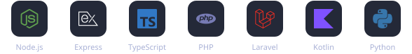

# Hi, I'm Xavier Romeu 👋

  
  
  
  

---

## 🧑‍💻 About me

I'm a **Tech Lead and backend-focused engineer** who has been building software that real businesses run on every day since 2020 — payments, ERPs, payroll and the mobile apps around them.

- 💳 **Tech Lead at Cucunver** — leading a team of 3 developers on **CucunverPay**, a proprietary payment platform built from scratch: a **Node.js** payment core integrated directly with **Redsys, Digiteal and Exthand**, alongside a multi-tenant **Laravel** platform for nonprofits, running on **AWS and Google Cloud**.
- 🐟 **Freelance, since 2020** — the internal software of **Deltamar**, a seafood distribution & aquaculture company: Firebird ERP integrations, payroll and time-tracking, warehouse and delivery apps, and a Telegram bot that takes customer orders straight into the ERP.
- 📱 **Mobile apps for clients** — React Native apps with Kotlin backends, built end to end as sole developer (healthcare and mobility).
- ☁️ **Cloud** — hands-on with AWS (EC2, Lambda, API Gateway, RDS, S3, CloudFront, SQS/SNS, IAM, CloudWatch…) and Google Cloud (Cloud Run, Cloud Storage), with infrastructure as code via CloudFormation.
- 🎯 **Now:** moving deeper into **cloud & platform engineering** — AWS certifications, Terraform and Kubernetes.

---

## 🛠️ Tech stack

**Backend**
 

**Frontend & Mobile**
 

**Cloud & DevOps**
 

**Data**
 

---

## 🚀 Selected work

> Most of my work lives in private company repositories — here's what it covers.

| Project | What it does | Stack |
|---|---|---|
| **CucunverPay** | Payment platform for a multi-tenant nonprofit SaaS: direct Redsys, Digiteal and Exthand integrations, payment callbacks and retries, automated member notifications, payout reports stored on GCS | Node.js · Laravel · AWS · Cloud Run · GCS |
| **Deltamar business system** | ERP-style platform for a seafood distribution company: payroll, time-tracking, production control and analytics dashboards, synced with its Firebird ERP | Node.js · Express · React · Firebird · Firestore |
| **Order bot** | Telegram bot that lets clients and sales reps place orders with fuzzy product search, written directly into the ERP | Node.js · Firebird · MiniSearch |
| **Field mobile apps** | Delivery notes for drivers, worker time clock, warehouse stock, label printing and unloading tracking | React Native · Expo · Firebase |
| **Client mobile apps** | Caumma (psychology clinic bookings), Rentalk (driverless car rental with online payments), MedicalToLife (remote coaching with doctors and trainers) | React Native · Kotlin |
| **E-commerce storefront** | Online fresh-fish shop with weight-based pricing using Stripe manual capture | Next.js · Stripe |

---

## 📜 Certifications

| Certification | Status |
|---|---|
|  &nbsp;**AWS Academy Graduate – Cloud Foundations** | ✅ 2025 |
|  &nbsp;**AWS Cloud Practitioner** | 🔄 In progress |
|  &nbsp;**HashiCorp Terraform Associate** | 🔄 In progress |
|  &nbsp;**CNCF Certified Kubernetes Administrator (CKA)** | 🔄 In progress |
|  &nbsp;**AWS Developer Associate** | 📅 Planned |
|  &nbsp;**AWS Solutions Architect Associate** | 📅 Planned |
|  &nbsp;**AWS AI Practitioner** | 📅 Planned |
|  &nbsp;**AWS DevOps Engineer Professional** | 📅 Planned |
|  &nbsp;**AWS Solutions Architect Professional** | 📅 Planned |

<!-- When you pass one, change the status to ✅ and link your Credly badge, e.g.:
|  &nbsp;**[AWS Cloud Practitioner](https://www.credly.com/badges/XXXX)** | ✅ 2026 | -->

---

## 💬 Ask me about

Payment integrations · ERP & legacy database integrations · Node.js / Laravel backends · Turning messy business processes into software · AWS architecture

🌍 Català · Castellano · English

